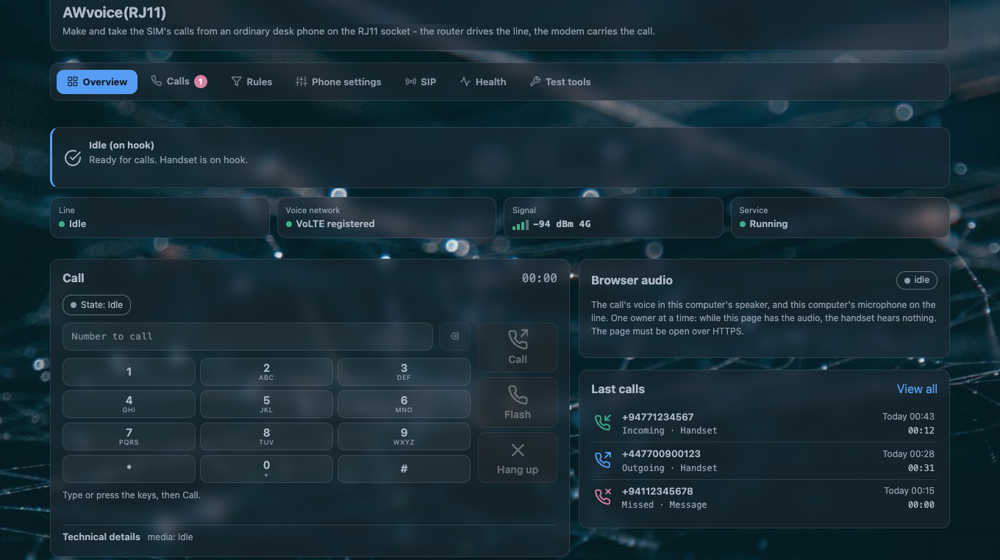
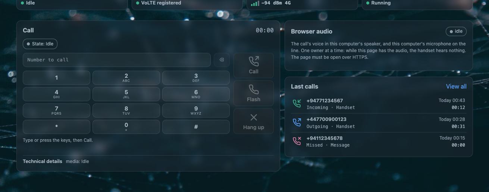
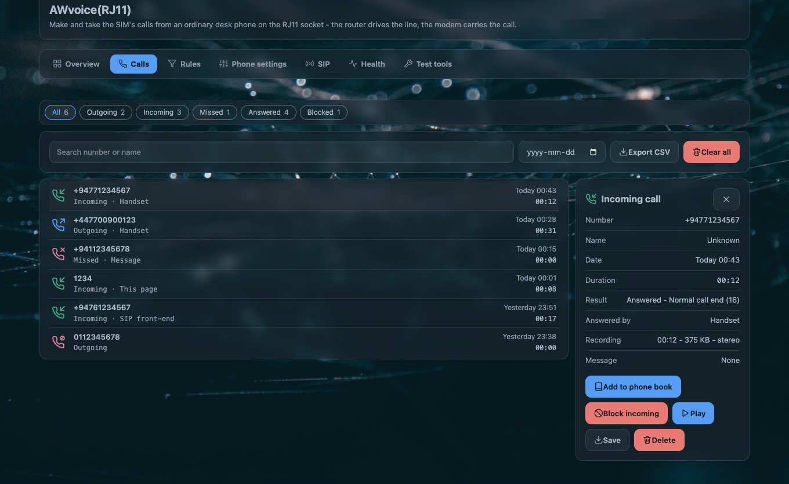
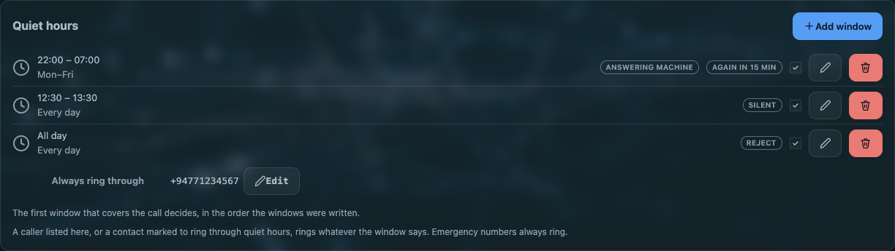
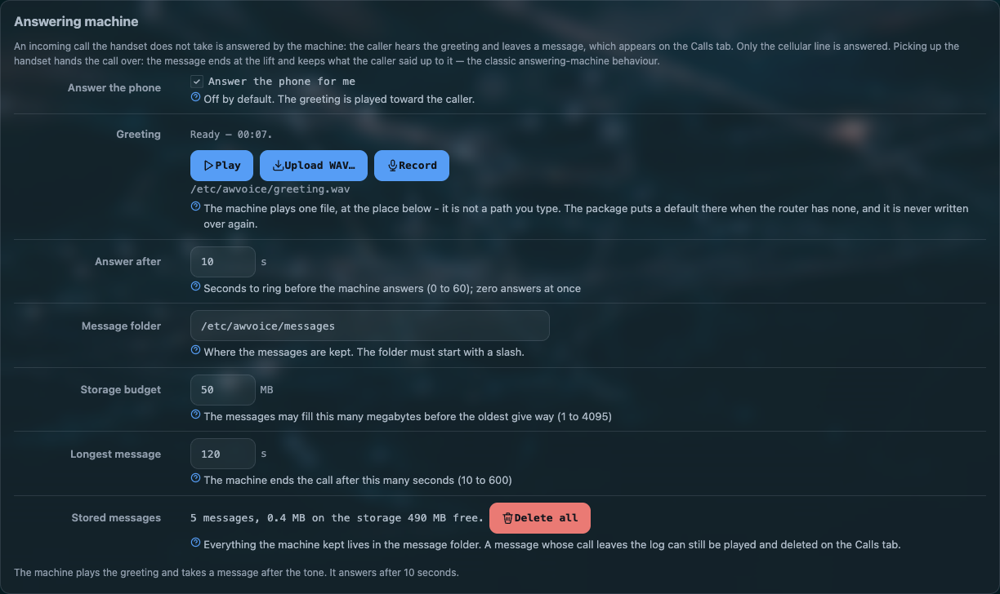
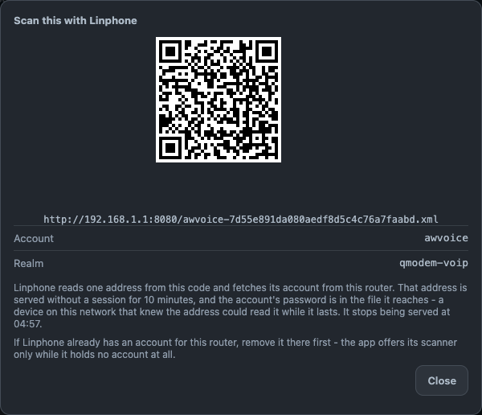
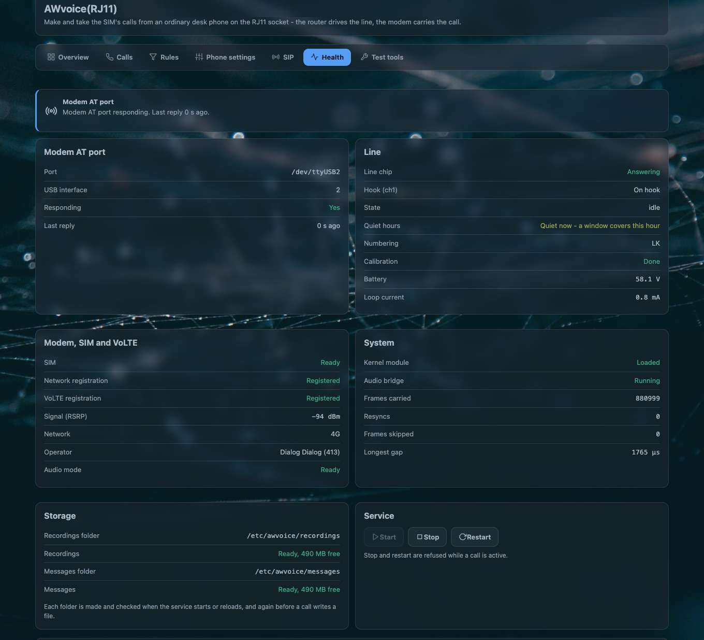

# AWvoice — an RJ11 phone port for the Arcadyan AW1000

<p align="center">
  
</p>

<p align="center">
  <strong>Plug an ordinary desk phone into the router's RJ11 socket and make and take the SIM's calls on it.</strong><br>
  No PBX, no second number, nothing in the cloud. The cellular network is the exchange, the SIM's number is the line's number,
  and every part of it runs on the router.
</p>

<p align="center">
  <a href="#quick-start">Quick start</a> ·
  <a href="#the-page">The page</a> ·
  <a href="#configuration-reference">Configuration</a> ·
  <a href="#architecture">Architecture</a> ·
  <a href="#verified-on-the-hardware">Measured on hardware</a> ·
  <a href="#troubleshooting">Troubleshooting</a>
</p>

<p align="center">
  <a href="https://github.com/Pr0Luci/openwrt-aw1000-voice-awvoice/actions/workflows/check.yml"></a>
  <a href="https://github.com/Pr0Luci/openwrt-aw1000-voice-awvoice/releases/latest"></a>
  
  
</p>

A kernel module drives the line chip over its register bus. One daemon serves the hook, the tones, ringing, caller id,
the log, the recordings, the answering machine and quiet hours, and talks to the modem's AT port directly — no extra
modem software in between. The LuCI page shows the state and every setting, and is a phone of its own.

> [!IMPORTANT]
> **The router is the phone.** Nothing has to be plugged into the RJ11 socket. Dialling, ringing, answering, hold and
> swap, the three-way join, quiet hours, the answering machine and the recordings all work from the browser page, and a
> call can go out and come in over a network phone on your own LAN instead. An analog handset is one more way to use the
> same line — the way it was first built to be used — not something the system needs.

**Three things worth knowing before you read further**

- Everything needed ships in the packages. A board file for this exact hardware is in the daemon package, and the first
  service start installs it. Install, reboot, dial.
- The network-phone side is a switch and it is off. Nothing changes on the line until you turn it on, and the handset
  and the page keep working with it off.
- Nothing here is called working until it was measured on a real AW1000 with a live SIM. The
  [numbers on hardware](#verified-on-the-hardware) are measurements, not expectations.

---

## Contents

| if you want to | go to |
| --- | --- |
| install it and dial | [Quick start](#quick-start) |
| see what each tab does, including the browser phone | [The page](#the-page) |
| look up a call feature or the LED | [Feature reference](#feature-reference) |
| find an option's values and default | [Configuration reference](#configuration-reference) |
| know where files live and which port the audio uses | [Files, ports and paths](#files-ports-and-paths) |
| read the protocol, the socket, the rings and the watchdog | [Architecture](#architecture) |
| see what was measured on a real router | [Verified on the hardware](#verified-on-the-hardware) |
| run the tests or build the packages | [Testing and building](#testing-and-building) |
| fix something that misbehaves | [Troubleshooting](#troubleshooting) |

---

## What's new in 1.1.3

- **The page is a phone.** A keypad, a call rail of **Call**, **Hang up** and **Flash**, two live level meters, and
  controls to answer or refuse a ringing call, mute the microphone or drop the audio. Hold and resume, taking a waiting
  call and then swapping the two, and joining two calls after a flash and `3` — all from the browser. A call answered in
  the page carries on at the handset the moment someone lifts it.
- **A network side for the line.** The SIP tab asks one question — who may use the phone line — and answers it with the
  page and the handset, or with a phone on your own network beside them. Saving starts or stops the SIP service on the
  router as part of the same action, and waits for a call in progress to end before it moves.
- **A code a phone can scan.** *Show a Linphone QR code* writes an account file of its own and names the address it is
  served from, so the soft phone sets itself up with nothing typed into it.
- **Quiet hours.** Windows of your own day when the phone must not ring, three answers for a call that arrives inside
  one, callers that ring through regardless, the same caller trying twice getting through, and `*78` / `*79` from the
  handset or the page.
- **HD voice that follows the hardware.** The setting is a wish; the modem is asked which rate it actually puts on the
  bus, and the line is brought up at that rate — only while nobody is using it, so a call is never cut.
- **The answering machine and the call log, joined.** A greeting ships with the package, is managed from one card
  (play, upload, record), and every message and recording is linked from its own call's card.

---

## Quick start

**Requirements:** an Arcadyan AW1000 with the RJ11 socket, running OpenWrt 25.12.5 (kernel 6.12.94, aarch64, target
`qualcommax/ipq807x`), a SIM with a voice plan, and an analog phone with a tone dial.

> [!IMPORTANT]
> Running [CleanWRT](https://github.com/Pr0Luci/cleanwrt-aw1000)? The phone port, this page and the packages are
> already in that firmware. Skip the installation and plug the phone in.

### 1. Install the three packages

Every release carries the three packages, their checksums and a short build record. Take all three from the **same**
release and reboot afterwards: the module and the daemon are a matched pair, and a module that is already loaded stays
loaded until a reboot.

| file in the release | package |
| --- | --- |
| `kmod-awvoice-fxs-6.12.94.1.1.3-r1.apk` | the kernel module (built for that exact kernel build) |
| `awvoice-phoned-1.1.3-r1.apk` | the phone daemon, the board file and the default greeting |
| `luci-app-awvoice-1.1.3-r1.apk` | the LuCI page |
| `SHA256SUMS`, `build-info.txt` | checksums, and the commit, SDK, feeds, kernel and target the build used |

```sh
cd /tmp
REL=https://github.com/Pr0Luci/openwrt-aw1000-voice-awvoice/releases/download/v1.1.3
for f in kmod-awvoice-fxs-6.12.94.1.1.3-r1.apk awvoice-phoned-1.1.3-r1.apk luci-app-awvoice-1.1.3-r1.apk SHA256SUMS; do
  wget "$REL/$f"
done
sha256sum -c SHA256SUMS

apk add --allow-untrusted \
  /tmp/kmod-awvoice-fxs-6.12.94.1.1.3-r1.apk \
  /tmp/awvoice-phoned-1.1.3-r1.apk \
  /tmp/luci-app-awvoice-1.1.3-r1.apk
reboot
```

> [!NOTE]
> The packages are not signed, which is why `--allow-untrusted` is needed. The module depends on the exact kernel build
> it was made for, so on any other kernel `apk` refuses it rather than installing a module that cannot load.
> `build-info.txt` names the commit and the SDK these files came from; two runs of one commit produce identical
> packages.

### 2. Make a call

At the next boot the service starts by itself: the board file is installed, the line is calibrated and ready, and the
page is at **Services → AWvoice(RJ11)**. The line is **on** as installed — `awvoice.main.enabled` defaults to `1`, and
the page's switch (or the option) is what turns it off. If the line was switched off:

```sh
uci set awvoice.main.enabled=1
uci commit awvoice
/etc/init.d/awvoice restart
```

Dial a number. Either of these is a working phone line, and neither needs the other:

- **with a handset on the line** — lift it and dial;
- **with the RJ11 socket empty** — open **Services → AWvoice(RJ11)** and dial from the page's keypad. The page's
  **Answer** button takes a call that comes in, and its **Hang up** ends it.

A network phone on your own LAN is the third way, once the SIP tab is switched on.

> [!TIP]
> Nearly everything is also on the page, and saving there applies and reloads in one action. The shell route above is
> for a first start or for an install over a serial console.

### 3. Optional, and worth two minutes

- **Record calls you answer** — Settings → Call recording. Off by default; a recording may need an announcement where you live.
- **Let the line answer for you** — Settings → Answering machine. Off by default; a greeting ships with the package, so it works the moment you switch it on.
- **Keep the phone quiet at night** — Rules → Quiet hours. Off until you write a window.
- **Answer from the browser** — the page's own phone needs one thing: the router's HTTPS certificate trusted by the browser. The page walks you through that once.

> [!WARNING]
> The RJ11 contacts sit at about 46 V, and higher while the phone rings. This is not certified telephone equipment. Do
> not rely on it for emergency calls, and check the rules that apply where you connect it. Emergency numbers are never
> blocked or dropped by anything on this router — that is a property of the design, not a guarantee of service.

---

## The page

One LuCI page, seven tabs. It reads the daemon over `ubus` (object `awvoice`) and writes the same file the shell reads,
`/etc/config/awvoice`.

### Overview — the line, and the phone in the browser

<p align="center">
  
</p>

The line's state, the call card, and the browser phone: a keypad, **Call**, **Hang up**, **Flash**, and two live level
meters so you can see both directions of audio while the call is up. With the handset down, the page answers a ringing
call, dials one, holds and resumes it, takes a waiting call and swaps the two, and joins two calls after a flash and
`3`. `MUTE` suspends the microphone alone.

Two rules hold the whole thing together:

- **The handset wins a lift.** Lifting the handset during a page call carries the call on at the phone: the log says
  `the handset takes the front end's call`, that call's card says the handset answered it, and the page's microphone and
  speaker stop with it. A call the page put on hold is not taken by a lift — the lift gets the recall dial tone and the
  held call stays the page's.
- **One owner of the playback ring.** Exactly one thing may send audio toward the caller at a time: nothing, the
  greeting, a network phone, or the page. The handset sits on the same ladder, which is why a lift ends a browser
  session cleanly instead of fighting it.

The page cannot take a call the handset already holds, and never interrupts a call in progress. What its **Answer**
button can take over is the call the answering machine holds.

<details>
<summary>How the browser audio reaches the line</summary>

One HTTP request becomes a WebSocket (RFC 6455) on the router's LAN address, port **7443** by default (`web_port`,
`web_iface`), and carries this daemon's own frames: twelve header bytes (marker, version, type, sequence number,
timestamp) followed by 160 samples of 16-bit linear audio in network byte order — 20 ms at 8 kHz. At 16 kHz the same
path carries two time samples per frame, packed the way the kernel reads them, so a wideband call is not stretched.

Admission is a token minted by the daemon's own `ubus` method for the call revision the page is looking at: single use,
thirty seconds, sent in the **first frame** of the encrypted stream — never in a URL, never in a log, never in a form
field. A refused page is told which fixed reason applied: `refused-busy`, `refused-nocall`, `refused-revision`,
`refused-mode`, `refused-rate`, `refused-port`, `refused-object`.

The stream is TLS on the router's own HTTPS pair (`/etc/uhttpd.crt`, `/etc/uhttpd.key`, both settable), not WebRTC.
That is a deliberate choice: the allowed libraries stop ICE, SRTP and Opus, the audio has to land sample-exactly inside
the audio bridge and the recording mirror, and a LAN peer needs no NAT traversal, no jitter buffer and no codec
adaptation.

</details>

### Calls — the log, the recordings, the messages

<p align="center">
  
</p>

Search, filters and CSV export. Each call's own card holds what that call left behind: **play**, **save** or **delete**
its recording, or its answering-machine message.

- **Recordings** (`record_enabled`, off by default) land as WAV on the router: stereo — the caller and the handset on
  separate channels — 16 kHz when HD voice is on, with a size budget (`record_max_mb`, 50 by default) that removes the
  oldest once the folder passes it.
- **No file name ever carries a phone number.** A file is named for the call's time and id.
- A call the answering machine answered is kept as its **message** instead. Pick the handset up mid-message and the
  message ends at the lift; the rest of the conversation is not recorded — the classic take-over behaviour, the same as
  standard voicemail.

### Rules — quiet hours, and who rings through

<p align="center">
  
</p>

A window is a start and an end — `22:00` to `07:00` is tonight through midnight, not nothing — a list of weekdays, or
all day. Up to eight windows, and **the first window that covers the moment decides**, in the order they are written.

| the window's mode | what happens to a call that arrives inside it |
| --- | --- |
| `silent` | the line stays silent. The page says the call is held quiet, **Answer** takes it, and lifting the handset answers it too |
| `machine` | the call goes to the answering machine. Needs the machine switched on; with it off the caller hears nothing from this side until the network ends the call |
| `reject` | the caller is released |

Callers reach you whatever the window says:

- an emergency number — always, and nothing on the router blocks one;
- a number on the window's or the page's **ring through** list (twenty at most, joined across windows);
- any number of a contact marked **Ring through quiet hours**, recognised however the network happened to write it;
- a caller who tries again inside the window's repeat time (`repeat_min`, new windows start at 15 minutes; `0` turns
  that answer off).

`*78` and `*79`, with or without the send key, typed on the handset or in the page's dialler put the line on quiet by
hand and take it off again. That ask outlives a save of anything else; a restart of the service falls back to the
windows written down.

> [!NOTE]
> Nothing is honoured from a schedule before the router knows what time it is. A clock still at 1970 would match every
> window or none, so an unknown time never quiets the line. A quiet asked for by hand needs no clock at all. The Health
> tab says what the line answered a moment ago and what decided it.

### Settings — the answering machine and its greeting

<p align="center">
  
</p>

The machine plays one file, always at `/etc/awvoice/greeting.wav` — its place is not a setting. The package carries a
short default and the first start that finds nothing there copies it in; after that the file is yours and an upgrade
never writes over it.

| control | what it does |
| --- | --- |
| **Play** | hears the file in the browser exactly as it stands on the router — including a file the machine cannot use, which is how you recognise one. Off when there is nothing there to read |
| **Upload WAV…** | the browser decodes and resamples to 8 kHz mono, so a recording from a phone or a computer in any usual rate works. The daemon checks the result again, writes a temporary file and moves it into place, so an interrupted upload cannot leave a half greeting |
| **Record** | takes your voice from the computer's microphone; the service trims the silence off both ends and adds the short tone that tells the caller to start talking |

Accepted: a 16-bit PCM WAV at 8 or 16 kHz, at most 2 MB. A file the machine cannot read switches the machine off rather
than answer with noise, and the card says which it found. Delay before answering is yours (`machine_delay`, 10 s by
default; `0` answers at once), a message is capped by `machine_max_s` (120) and by `machine_max_mb` (50), and messages
live in `/etc/awvoice/messages`.

```sh
# the same file, if you prefer to keep your own recording out of the browser
scp greeting.wav root@<router-ip>:/etc/awvoice/greeting.wav
/etc/init.d/awvoice restart
```

### SIP — a phone on your own network

<p align="center">
  
</p>

The SIP tab is the one place that asks whether a phone on your own network may join the line. The answer is this port's
own setting; the service that carries the network phone is a separate program on the router with its own settings, and
the page treats it as exactly that.

- **The mode card** has two answers — the page and the handset, or them and a network phone. Saving writes the side and
  then starts or stops that service; with a call in progress the service moves once the call ends rather than being cut.
  The card says which outcome happened: started, stopped, waiting for the call, no SIP service installed here, this
  account may not start or stop it, or the service did not answer and the move is yours to make.
- **The account** a soft phone signs in with — its name, its realm, and a password you type rather than one handed to
  you — belongs to that service. The card reads its own settings back: which file the service uses and whether its
  password file is in place. Never the content of a credential.
- **Two guards** keep a second front end from fighting this line: whether another process holds the modem's voice AT
  port, and whether the object name `qmodem_voip` is already registered. They are checks, not negotiation — this port
  never opens, closes, stops or reconfigures another program's things — and both are asked again at start, on a settings
  reload, on a modem hotplug and on the daemon's slow re-check. The port decides whether the line may run this front end
  at all; the name decides only whether the network side may offer `qmodem_voip`, so a name held elsewhere never stops
  the page or the handset.

### The code a phone scans

<p align="center">
  
</p>

*Show a Linphone QR code* writes an account file, shows the address it is served from as a code, and the app fetches
that file and builds the account itself. Nothing is typed into the phone.

- The file is written by `/usr/libexec/awvoice-provision` into `/www/awvoice-provision` under a random name
  (`awvoice-<32 hex>.xml`), and the code carries one URL and nothing else, because a provisioning URL is what that app
  expects to read from a code.
- The lifetime is ten minutes. The card names the minute the address stops being served, and the daemon keeps that
  promise: its own round runs every 60 seconds and retires the files this feature wrote once their lifetime is through.
  Nothing else in that folder is touched — it sits inside the web server's document root, and anything else there
  belongs to someone else.
- The file carries the account's password in clear and is served on the LAN, so show a code while the phone is beside
  you. If the app already holds an account for this router, remove it there first: that app offers its scanner only
  while it holds no account at all.
- When no code can be made, the card says why in words rather than a code: the network phones are switched off, there is
  no account name yet, the stored password cannot be read back (type it once, or make a new one), the network has no
  address right now, or this router serves no plain address a phone can fetch — that listener belongs to the web
  server's own configuration.

### Health and Tools

<p align="center">
  
</p>

Health reports the facts rather than an opinion: the HD-voice wish, the modem's own answer, and the rate the audio path
came up at — `hdVoice`, `audioRate`, `voiceLayout` — so a mismatch is visible instead of inferred; which process owns
the front-end name; whether the folders for recordings and messages exist and are writable and how much room is left;
and what the line answered the last call and what decided it.

Tools holds the line test and the ring test: the ringer, the tone chain, the chip's readings, the caller-id
transmission. A phone's ringer can draw more than the chip's AC ring detector tolerates, and the test shows that rather
than a dead line — the burst is cut and the reason is logged (`the chip's ring trip fired before any lift`).

---

## Feature reference

| calls | |
| --- | --- |
| Dial (tone), ring, answer, hang up | yes |
| All of it with the RJ11 socket empty — the browser page is the handset | yes |
| Hook-flash (R), call waiting with hold and swap | yes |
| Three-way join — after a flash, `3`; switchable off in Settings | yes |
| Hold recall — put the handset down while another call waits and the held call rings back | yes |
| Progress tones, or hand the ringback to the network (`ringback auto|on|off`) | yes |
| Caller id on the handset's display — FSK (Bellcore or ETSI) or DTMF, before or after the first ring | yes |
| Calling-line restriction, network service codes, hotline number | yes |
| Three-digit service codes need a long hook break: the handset's flash window and the three-second code window are separate | by design |
| Emergency numbers | never blocked by anything here |

| the rest | |
| --- | --- |
| Call log with search, filters and CSV export | yes |
| Phonebook with speed dial, alarm (wake-up) calls, line and ring tests | yes |
| Call recordings — stereo, 16 kHz with HD voice, opt-in, size budget, no numbers in file names | yes |
| Answering machine — greeting, messages in the call log, mid-message take-over | yes |
| Quiet hours — windows, three modes, ring-through list, `*78` / `*79` / `#` | yes |
| HD voice — 16 kHz end to end, following the modem's own answer | yes |
| Numbering plans — 43 regions, auto-detected from the network the line registers on | yes |
| Browser phone over an encrypted LAN stream | yes |
| Network phone (SIP) on the same line, off by default | yes |
| Soft-phone setup by scanning a code | yes |
| The phone LED follows the line: solid while ready, fast blink while ringing, slow blink off hook, each rate settable | yes |

---

## Configuration reference

Everything lives in one UCI file, `/etc/config/awvoice` — `awvoice.main` for the line, `awvoice.sip` for the network
side, one `dnd` section per quiet-hours window, `contact` sections for the phonebook. The page writes the same file.

| option (`awvoice.main`) | values | out of the box | meaning |
| --- | --- | --- | --- |
| `enabled` | `0` \| `1` | `1` | the switch for the whole phone line. The page's own switch writes it, and the line works as installed |
| `channel` | `0` \| `1` | `1` | which of the chip's two channels is the line |
| `board` | a path | `/etc/awvoice/board.bin` | the board file: the chip's operating values |
| `at_interface` | `0`–`9` | `2` | the modem's USB interface holding the AT port |
| `dial_pause_s` | `3`–`15` | `6` | how long a pause between digits ends the number |
| `cid` | `dtmf` \| `bellcore` \| `etsi` \| `off` | `dtmf` | caller-id signalling on the line |
| `cid_when` | `ring1` \| `prering` | `ring1` | after the first ring, or in the gap before it |
| `ringback` | `auto` \| `on` \| `off` | `auto` | local ringback, or the network's own audio once it is heard |
| `hd` | `0` \| `1` | `0` | HD voice wanted. The modem is asked for that rate and the line follows its answer |
| `region` | `auto` \| a region name | `auto` | the numbering plan that decides display form; `auto` follows the network |
| `flash_min_ms` / `flash_max_ms` | `20`–`500` / `300`–`3000` | `80` / `300` | the hook-flash window: shorter is ignored, between the two is the handset's flash (R), longer is on hook. `flash_max_ms ≥ flash_min_ms + 100` |
| `led` | an LED name, or `''` | `green:phone` | the indicator; `''` leaves the LED alone |
| `call_waiting` | `0` \| `1` | `1` | the three-way join after a flash and `3` |
| `ring_rate_ms`, `offhook_rate_ms` | milliseconds | `300`, `1000` | the LED's blink rates while a call rings and while the handset is up |
| `hotline_delay_s` | seconds | `10` | the delay before the hotline number is dialled, when a hotline is set |
| `earpiece_volume`, `modem_rx_gain` | numbers | unset | written to the modem only when set |
| `my_number` | digits | unset | shown on the page only; nothing is dialled from it |
| `record_enabled`, `record_path`, `record_max_mb` | `0|1`, a path, MB | `0`, `/etc/awvoice/recordings`, `50` | call recordings |
| `machine_enabled`, `machine_delay`, `machine_max_s`, `machine_max_mb`, `machine_path` | `0|1`, seconds, seconds, MB, a path | `0`, `10`, `120`, `50`, `/etc/awvoice/messages` | the answering machine. The greeting is **not** an option — one fixed file, managed from the card |
| `web_port`, `web_iface`, `web_cert`, `web_key` | number, an interface name, paths | `7443`, `lan`, `/etc/uhttpd.crt`, `/etc/uhttpd.key` | the browser phone's encrypted audio stream |

| option (`awvoice.sip`) | values | default | meaning |
| --- | --- | --- | --- |
| `mode` | `web`, or the words that name a network phone and say what serves it | `web` | whether a phone on your own network may join the line. Saving also starts or stops that service. A word this build does not know is refused and said so, and the line stays on the side it was on |

```ini
# /etc/config/awvoice — one quiet-hours window, weekdays only, machine answers
config dnd 'night'
        option enabled '1'
        option from '22:00'
        option to '07:00'
        option days 'mon tue wed thu fri'
        option mode 'machine'
        option repeat_min '15'
        list allow '+94771234567'

config contact 'family'
        option name 'Family'
        option ring_through '1'
```

A `from` later than its `to` runs through midnight. No `dnd` section means no quiet hours: the phone rings at every
hour, as it does out of the box. Every window's `allow` list joins one list of at most twenty numbers, and a contact
marked `ring_through '1'` needs nothing else written anywhere.

<details>
<summary>Settings the page does not show</summary>

`at_interface` and `led` are the two that usually matter, and both ship with working values for the AW1000. The rest of
the file has defaults in the daemon (`awvoice-phoned/src/daemon/config.c`), and an invalid value is reported in the log
and the default is used instead:

```sh
logread -e awvoice | tail -20
```

</details>

---

## Files, ports and paths

| where | what it is |
| --- | --- |
| `/etc/config/awvoice` | the settings: the line, the network side, the quiet-hours windows, the contacts |
| `/etc/awvoice/board.bin` | this board's chip values, installed by the first service start from the package |
| `/etc/awvoice/greeting.wav` | the greeting the answering machine plays. One fixed place, never a setting |
| `/usr/share/awvoice/greeting-default.wav` | the packaged default, copied in only when the router has none |
| `/etc/awvoice/recordings/` | the call recordings |
| `/etc/awvoice/messages/` | the answering machine's messages |
| `/www/awvoice-provision/awvoice-<32 hex>.xml` | the account file a scanned code points a soft phone at, retired after ten minutes |
| `/usr/libexec/awvoice-provision` | the writer of that file |
| `/etc/uhttpd.crt`, `/etc/uhttpd.key` | the certificate pair the browser audio stream uses by default |
| TCP `7443` on the LAN address | the browser phone's encrypted audio stream (`web_port`) |
| ubus object `awvoice` | every method the page calls |

Everything under `/etc/awvoice/` is kept across a sysupgrade (the package ships a keep list), and appears in a
`sysupgrade -b` backup.

---

## Security notes

> [!WARNING]
> The provisioning file written for a scanned code carries the account's password in clear and is served on the LAN for
> ten minutes. Show a code while the phone is beside you, and nothing about the feature is reachable from outside the
> network.

> [!NOTE]
> Browser audio is admitted by a single-use token that is valid for thirty seconds and travels in the first frame of an
> encrypted stream — never in a URL, never in a log, never in a form field. One page at a time can hold the microphone.

> [!NOTE]
> The credentials a network phone signs in with belong to the separate SIP service on the router. This port reads which
> file holds them and whether that file is in place, and never displays or logs a secret.

> [!CAUTION]
> The packages are unsigned, so `apk` needs `--allow-untrusted`. Verify `SHA256SUMS` before installing, and install all
> three packages from one release.

---

## Architecture

### The three packages

| package | it is |
| --- | --- |
| `kmod-awvoice-fxs` | the kernel module: the line chip's register bus, the PCM block, the audio bridge between the modem and the chip, the capture tap for the recordings and messages, the playback ring that carries a greeting and the page's voice to the caller, and the ring watchdog. GPL-2.0-only |
| `awvoice-phoned` | the phone daemon: the hook, the tones, dialling, ringing, caller id, the call log, the recordings, the answering machine, quiet hours, the page's audio stream, the front end a network phone speaks through, and the `ubus` service `awvoice` |
| `luci-app-awvoice` | the LuCI page, **Services → AWvoice(RJ11)**: Overview, Calls, Rules, Settings, SIP, Health and Tools |

### A watchdog, not a promise

A thin module owns the register bus, the PCM block and a hardware ring watchdog: if the phone service ever stops, the
chip is back in reset within milliseconds — the phone never rings forever and the line never stays live. All the line
logic sits in one daemon on a single 5 ms clock, and the whole core builds and runs on an ordinary computer with no
hardware attached.

### The 20 ms frame is the unit everywhere

The kernel bridge hands out one frame per 125 µs slot: 160 slots at 8 kHz, two time samples per slot at 16 kHz. The
capture side and the playback side are the only two places that convert it, and nothing else counts slots. The caller's
voice reaches the daemon through a lock-free capture ring and a greeting goes back through a matching playback ring; an
empty ring is silence with a counted underrun, never a stale frame from an earlier call, and the bridges' stop and start
reset both rings.

### The front end's socket (QMSK)

Between the daemon and the front end that carries a network phone: one message per 20 ms frame over a unix seqpacket —
a stream at the same path where a kernel refuses seqpacket — non-blocking throughout, with no threads and no clock of
its own. A frame is twelve little-endian header bytes (magic `0x514d534b`, version, type, payload length) plus payload,
and the interface carries 8 kHz only, so a media frame is always 160 samples and any other count is refused with an
error frame and the peer closed. A heartbeat carries nothing, answers nothing and refreshes the binding it belongs to.

### One gate for every action

Answer, dial, hang up, DTMF and route each carry the call revision the asker saw, and a refusal never changes the call.
A hang-up for a call that has already ended is accepted, because the intent is satisfied and two people ending a call at
the same moment is not an error; answering a call that is not ringing is refused rather than answered early; a front end
may take less than the call carries, never more.

### HD voice is a wish, and the modem decides

The chip's band, the PCM slots and the audio bridge are one layout, and the slots can only change while the bus is down.
So the service asks the modem which rate it actually puts on the bus (a read-only question) and only when the modem
answers with the rate that was asked for is the line brought up at it — and only while nobody is using the line. An owe
raised while the handset is up waits for the line to clear. Changing the rate does restart the modem, so mobile data
drops for about half a minute; a modem that keeps answering the other rate is asked a bounded number of times and the
line then keeps working at the rate it has, with the reason in the log. The health reply carries the setting, the modem's
answer and the layout the path came up at as three separate facts.

### The board file, and the chip's firmware

The line chip needs this board's own values — line voltages, ringing, tones, impedances, the init sequence. A ready
board file ships with `awvoice-phoned` and the first service start installs it at `/etc/awvoice/board.bin`; a file
already there is never overwritten. If you would rather derive your own from your router's original firmware, the same
format is produced by `tools/provision/awvoice-board-extract.py` with the section map in `tools/provision/aw1000.map`.

Why the board file ships here: its contents are operating parameters, functional values the hardware requires, not the
chip maker's executable code. The values were read from the board's own stock firmware, the extractor and the section
map that derive them from your own firmware ship here, and the same operating values are already public in source form
in other open-source projects.

The chip runs on the firmware built into it. This port uses **no DSP patch file** — none is needed, and none ships. The
port never uploads or redistributes a proprietary binary: the chip's ready state is checked at every service start, and
if a unit's chip did not come up the service stops with that cause in the log instead of leaving a silent dead line.

---

## Verified on the hardware

The host suites below prove the logic on an ordinary computer. This section is the runs on the router itself — an AW1000
with a live SIM, OpenWrt 25.12.5, kernel 6.12.94, aarch64. Nothing is called working here before a call has gone
through the actual hardware.

**Nothing in the RJ11 socket, 6 November 2026.** The phone cable was unplugged from the AW1000 and the line left
running. A call was dialled from the page's keypad and one was answered with the page's **Answer** button, both with
voice in each direction, and the same two directions were then run through a network phone on the LAN — the page and
the network phone working beside each other on the same empty socket. The readings say why that works: the hook state
comes from the chip's register, not from a handset's loop current, and the battery and loop-current samples in the
bring-up and the ring are written to the log without deciding anything. The only place a loop current is judged is the
line test, where a high reading is reported as a leak suspect.

**HD voice (16 kHz), 2 November 2026**

- HD on while the modem already kept 16 kHz: the line came up narrowband first, the modem's read-only answer arrived
  0.5 s later, one bring-up followed, and the log ends `the line is in service at 16000 Hz` about 4 s after the setting.
  The modem was not restarted and mobile data did not drop.
- HD off, then HD on again: the rate was written, the modem restarted, its AT port came back 14 s and 16 s later, the
  read answered 8 kHz then 16 kHz, and the line was in service at 8000 Hz 47 s after the setting and at 16000 Hz 46 s
  after the next one. Both directions with `modemTimeouts: 0` and no faults.
- Three calls at 16 kHz, recorded: a 66 s call's file is **65.573 s**, a 58 s call's is **57.541 s** — 16 kHz stereo,
  both channels carrying voice, **no clipped 20 ms window in either file**. The machine's 15 s message is **14.766 s**
  and its greeting played its own length (4.43 s), so the rate is right in the capture and in the playback.
- Band, measured from the recording (195 windows of 2048 samples over the first 20 s): the caller's channel holds
  **4.68 % of its energy between 3.4 and 4 kHz and 4.07 % between 4 and 5 kHz**. A narrowband call upsampled to 16 kHz
  is empty above 4 kHz, so the file's header and its data agree.
- **Not claimed:** the handset's own transmit band measured 0.02–0.08 % above 4 kHz in the same files, which is what the
  line chip's transmit filter gives. The receive direction is proven wideband; a tone test in the 4–5 kHz band is owed
  before the transmit width is claimed.

**Answering machine and recordings, 30 October – 2 November 2026**
An unanswered call was answered 10.7–10.8 s after it came, the greeting went out with no frame dropped (one counted
underrun — a single late frame), and the message was kept and linked in that call's card. Picking the handset up during
the machine's call hands the conversation over: a take-over five seconds into the greeting left no message, because none
had begun. At 8 kHz the recordings are stereo with both channels carrying voice and the file's length matching the call
log — a 407 s call's file is 13,044,540 bytes, exactly 407 s of 8 kHz stereo.

**The page's phone, 31 October – 1 November 2026**
An incoming call answered with the page's Answer button ran two-way audio for 64 s with both channels of its recording
carrying a voice, and a call dialled from the page's keypad reached the network and both sides talked. Hold and resume
(`flash: the call is held`, `flash: the held call is taken back`), a waiting call taken and then swapped, two calls
joined after a flash and `3`, and a page call taken back by a handset flash are all in the log — the page's flash is a
100 ms break inside the 80–300 ms hook window, with the 3 s code window kept separate from it.

**Caller id, 29 October 2026**
The number and the phonebook's name reached a handset display, and the transmission was decoded from a recording of the
line: 304 alternating bits, 186 mark bits and the framed message with a good check.

**The line and the ring**
One phone's ringer draws more than the chip's AC ring detector tolerates, and the supervision shows that rather than a
dead line: the burst is cut and the reason is logged (`the chip's ring trip fired before any lift`) instead of repeated
short chirps. With a second phone, ten back-to-back ring tests held 57–96 V on the ring rail at ±3–6 mA and every call
rang. An outgoing call the network released before the answer plays the busy tone.

**The network side and the scanned code, 4–5 November 2026**
A code shown on the SIP tab was scanned by a soft phone on the same network: it fetched the account file the router
served, made its account and registered. Calls then went over that account in both directions with voice each way, while
the handset and the page went on working beside it. The account file was gone from the served folder once its lifetime
was through, and the card had named that minute in advance. Where another program already held the name
`qmodem_voip`, the health reply said so plainly — and the page's phone and the handset were unaffected, because that
guard reports and never takes over.

**Install and boot**
The three packages upgrade in place with `apk` and the delivered defaults are off — the recordings, the answering
machine and the SIP side. After a reboot the service comes by itself: board file installed, line ready and calibrated,
the greeting loaded, and every stored file hash-identical to before.

---

## Testing and building

### Host tests

38 suites, 35 in the daemon and 3 in the module, built and run on an ordinary computer with no hardware attached, under
AddressSanitizer and UBSan. The line logic lives in hardware-independent modules on purpose, so the tests reach all of
it.

```sh
cd awvoice-phoned && make -f Makefile.host test
cd kmod-awvoice-fxs && make -f Makefile.host test
```

They cover what can be decided from the data alone: the call stages and the modem's queue, the blocking and forwarding
rules, the caller-id framing, quiet hours, the storage checks, the greeting's trimming and its tone, the page's protocol
and its refusal words, the two guards and the media socket, the gate every action passes, and the sweep that retires an
account file a scanned code pointed at. Every fix's test is first seen to fail with that fix reverted, then green with
it restored — a test that survives the reverted fix proves nothing.

### A release build you can reproduce

The release workflow builds inside a pinned Debian container against a checksummed OpenWrt SDK, from
`git archive` of the tag, so a file that never entered the repository cannot enter a package. The module's vermagic,
the binary architectures and the daemon's library list are checked before anything is packaged. Two runs of one commit
produce byte-identical packages, and `build-info.txt` records the version, commit, SDK hash, feed pins, kernel, target
and time.

```sh
scripts/build.sh          # the package set, inside the pinned builder image
scripts/test.sh           # the host suites, the same ones CI runs
scripts/version.sh set 1.1.4   # walk VERSION and the three PKG_VERSIONs together
```

### Build from source

The repository carries the standard OpenWrt feed layout, and the module builds only in the target tree
(`qualcommax/ipq807x`):

```sh
cd openwrt
echo 'src-git awvoice https://github.com/Pr0Luci/openwrt-aw1000-voice-awvoice' >> feeds.conf
scripts/feeds update awvoice
scripts/feeds install kmod-awvoice-fxs awvoice-phoned luci-app-awvoice
make menuconfig      # Kernel modules → Other modules: kmod-awvoice-fxs · Utilities: awvoice-phoned · LuCI → Applications: luci-app-awvoice
make -j"$(nproc)"
```

Or copy the three package directories at the repository root into the build tree's `package/` directory instead.

---

## Troubleshooting

| what you see | what it means |
| --- | --- |
| The service stops at start and the log names the chip's ready state | that unit's line chip did not come up. The service stops with the cause instead of leaving a silent dead line |
| `apk` refuses the module package | it was built for kernel 6.12.94 and your running kernel is another build. Install all three packages from one release on the firmware that release was made for |
| The page's **Call** does nothing and the audio step is still shown | the browser does not trust the router's HTTPS certificate yet. Do that one-time step, then reload the page |
| The page's phone is refused with a `refused-*` word | `refused-busy` — another page holds it; `refused-nocall` — there is no call for that revision; `refused-revision` — the page is looking at an older call; `refused-mode` — the side the line is on does not offer the page; `refused-rate` / `refused-port` — the stream's rate or address moved; `refused-object` — the daemon's object is not there |
| A handset with one ringer chirps instead of ringing, and nothing answers | the ringer draws more than the chip's AC ring detector tolerates and the burst is cut. The log says `the chip's ring trip fired before any lift`. The Tools ring test shows the same reading |
| The flash key does nothing, or a call drops instead | the handset's flash is outside the window. Raise `flash_max_ms` (a 600 ms key needs 800, a 1000 ms key 1200) |
| The answering machine stays off and the card says the greeting cannot be used | `/etc/awvoice/greeting.wav` is not 16-bit PCM at 8 or 16 kHz within 2 MB. **Play** on the card hears exactly what the machine sees |
| Quiet hours do nothing | the router's clock is not set. An unknown time never quiets the line, on purpose; `*78` works regardless |
| A network phone registers and calls then fail with `cellular originate rejected` | another program holds the front-end name and the voice path. The Health tab names the owner; this port reports and never takes over |
| The SIP card says there is no SIP service installed here | the service that carries a network phone is a separate package; it is not on this router |

---

## Licence

GPL-2.0-only — see [LICENSE](LICENSE). Each of the three packages carries the same licence in its own `PKG_LICENSE`,
and the kernel module's `COPYING` is the GPL text it names.

Not certified telephone equipment. Do not rely on it for emergency calls. Maintained by
[Pr0Luci](https://github.com/Pr0Luci).
